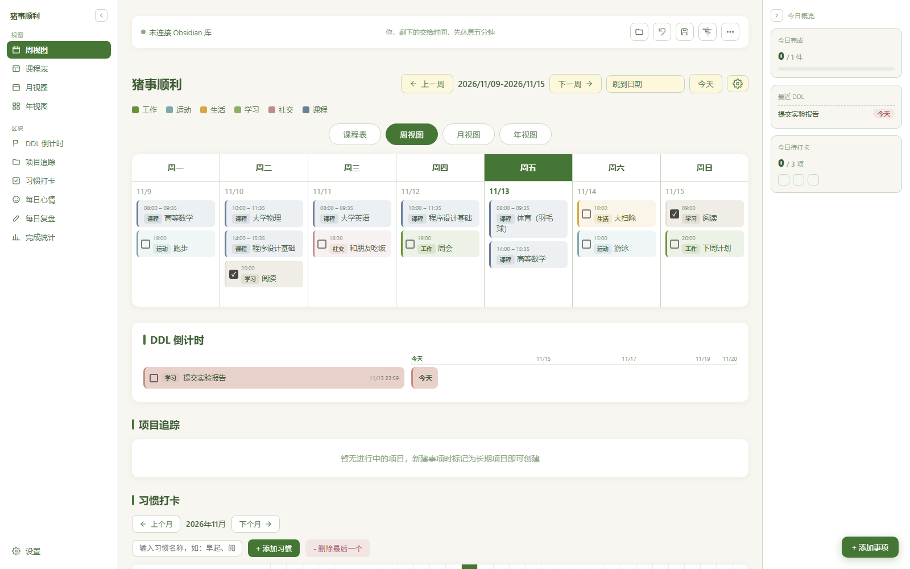
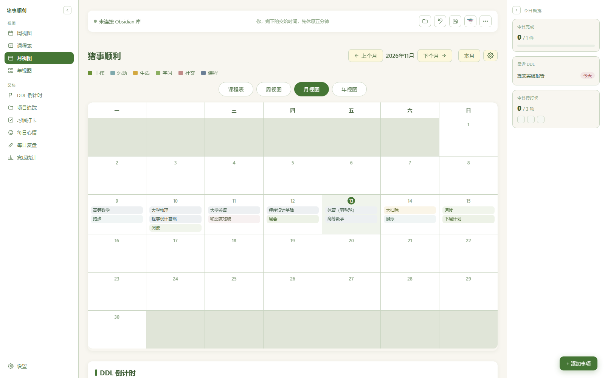
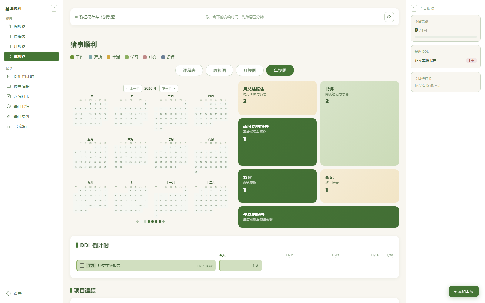
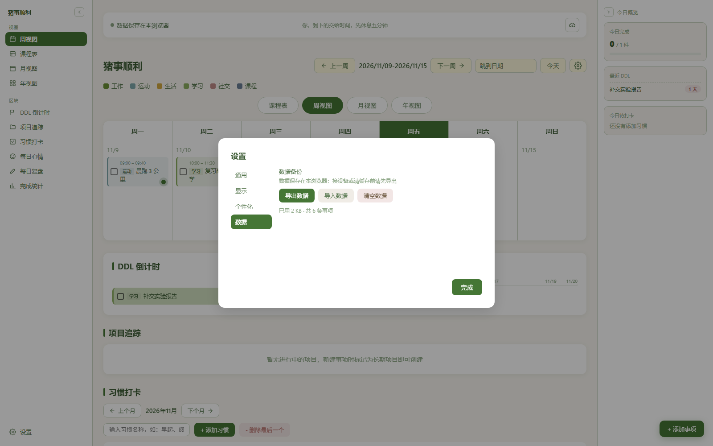

# 猪事顺利 · Zhushroom

一个单文件的本地日历应用：周 / 月 / 年视图、课程表、DDL 倒计时、习惯打卡、每日心情、每日复盘与项目追踪，数据和 Obsidian 库双向同步。



## 特点

- **单文件**：整个应用就是一个 `猪事顺利.html`，不装依赖、不跑构建，双击即可用
- **本地优先**：数据存在浏览器 `localStorage`，不联网、不上传
- **与 Obsidian 双向同步**：日程、心情、习惯打卡、复盘、项目都写成 md，回到库里还能继续编辑
- **Obsidian 内一键打开**：配套插件把页面嵌进 Obsidian 标签页，并在启动时自动打开，读写 md 无需每次授权
- **主题与字号**：四套配色（莫奈绿 / 雾蓝 / 暖沙 / 藕荷）、三档字号，可自定义背景图
- **可选**：钉钉机器人推送日报，学在浙大 DDL 抓取（独立服务，不在本仓库）

## 快速开始

### 方式一：网站版（零安装）

打开 **https://falling-anyway.github.io/zhushroom/**，不用装任何东西。

- 数据存在你自己浏览器的 `localStorage` 里，不上传服务器；换设备或清缓存前先「设置 → 数据 → 导出数据」
- 也可以把 `猪事顺利.html` 下载到本地双击打开，效果一样

### 方式二：满血版（放进 Obsidian 库）

1. 把 `猪事顺利.html` 放到库的**根目录**
2. 把 `obsidian-plugin/zhushroom-full` 整个目录复制到库的 `.obsidian/plugins/` 下
3. Obsidian 设置 → 第三方插件 → 关闭安全模式 → 启用「Zhushroom Full」
4. 重启 Obsidian，页面会自动在标签页里打开；之后也能从左侧边栏的小猪/蘑菇图标点开

插件读 `猪事顺利.html` 原文塞进 iframe 渲染，页面读写的 md 全部经由 Obsidian API 落盘，不需要浏览器授权目录。数据写进库里的 `日程/`（目录名可在设置里改）：

| 目录 | 内容 |
| :--- | :--- |
| `日程/01-每日日程/` | `日程-YYYY-MM.md`、`心情-YYYY-MM.md` |
| `日程/07-习惯打卡/` | `习惯打卡.md` |
| `日程/08-文艺审美/` | `书评/`、`影评/`、`游记/` |
| `日程/_同步备份/` | 保存前的快照，用于「撤销上一次保存」 |

嫌麻烦也可以直接下 Release 里的 `zhushroom-full.zip`：页面、插件、同步助手、说明都配好了，按包内 `使用说明.txt` 放就行。

### 同步助手（可选）

不是第三种用法，是附加组件：不装也能用，只是课表要手填、学在浙大待办要手动抄。方式一、方式二都能配上它。

1. 下载 Release 里的 `zju-sync-helper.zip`，解压到任意目录
   - **不要用仓库首页的 Code → Download ZIP**：那里没有打包好的 `zju-sync-service.exe`，`.bat` 的行尾也会被改坏，双击一定报「不是内部或外部命令」
2. 双击 `登录一次.bat`，在浏览器里登录浙大统一身份认证，再打开教务网课表页一次
3. 双击 `start-hidden.vbs` 启动后台服务（监听 `http://127.0.0.1:8765`，只在本机）
4. 回到页面，点右上角云朵图标 →「立即同步」

助手只在本机跑，Cookie 与缓存都留在你的电脑上；想开机自启，把 `start-hidden.vbs` 的快捷方式放进 `shell:startup`。

## 使用说明

- 顶部连接栏：右侧四个图标分别是「选择 Obsidian 库」「撤销上一次保存」「保存到 Obsidian」「拉取学在浙大 DDL」，最后是更多菜单
- 点每列顶部的「周X」表头，可以直接为那一天添加事项
- 「添加事项」弹窗分「事项 / DDL」两个标签，DDL 只需要截止时间
- 课程表生成的课程事件不带勾选框，分类固定为「课程」，也不计入完成率统计
- 设置里有字号、配色、背景、称呼、钉钉 Webhook、侧边栏图标等

## 数据与隐私

- 日程、心情、习惯、复盘都存在浏览器本地 `localStorage`；连库后同时写 md
- 钉钉 Webhook 只存在本地，不会出现在仓库或 md 里
- 本仓库不含任何个人日程数据、登录凭证或同步服务的二进制文件

## 学在浙大同步（可选）

`zju-sync/` 是把教务网课表、DDL 拉进本页面的本地服务，默认监听 `127.0.0.1:8765`。

| 文件 | 说明 |
| :--- | :--- |
| `登录一次.bat` | 用浏览器登录一次教务网与学在浙大，抓取 Cookie |
| `zju-sync-service.exe` | 同步服务本体（二进制，未入库，需自备） |
| `start-hidden.vbs` | 后台静默启动服务 |
| `zju-sync.config.example.json` | 配置样例，复制为 `zju-sync.config.json` 后填自己的缓存目录 |
| `_归档/` | 早期版本的服务源码与油猴脚本，仅供参考 |

- Cookie 存在 `zju-cookie.txt`、`zju-cookies.json`，只留在本机，已在 `.gitignore` 里排除
- 服务缓存写在 `_cache/`，同样不入库
- 不需要同步时，页面里的「课程表」也能手动编辑

## 已知限制

- 用 `file://` 直接打开时，浏览器不保留目录授权，每个浏览器会话要手动选一次库目录；在 Obsidian 里用插件打开没有这个问题
- 页面依赖 Chromium 内核（Edge / Chrome / Obsidian 自带内核），Firefox 的 File System Access API 支持不完整
- 学在浙大 DDL 同步依赖 `zju-sync/` 里的本地服务，二进制未入库，需自行构建或从发布页获取

## 截图

| 月视图 | 年视图 |
| :--- | :--- |
|  |  |



## 开发与发布

应用在个人的 Obsidian 库里编辑，本仓库是发布副本：

```powershell
# 把库里最新的 html 与插件同步过来，检查后提交并推送
powershell -ExecutionPolicy Bypass -File tools\publish.ps1

# 只检查不提交
powershell -ExecutionPolicy Bypass -File tools\publish.ps1 -DryRun
```

脚本会先做安全检查（私有路径、凭证、二进制文件、脚本语法），通过后才提交。

## 许可

[MIT](LICENSE)
